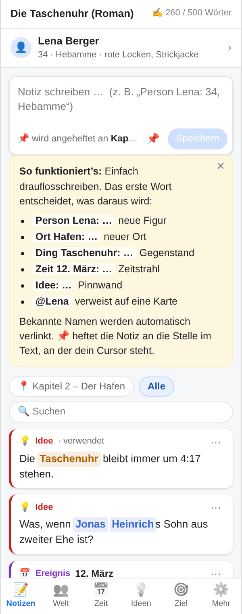
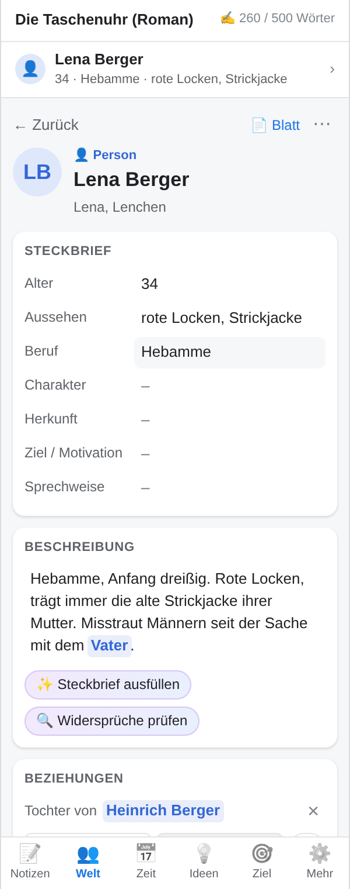
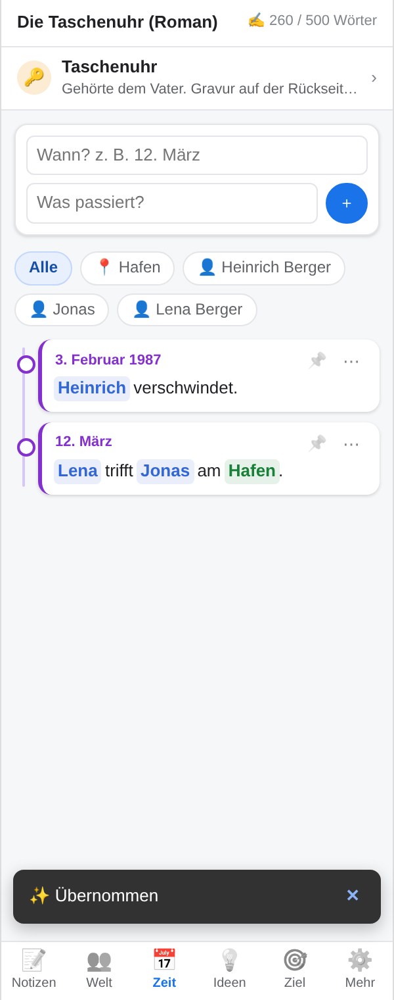
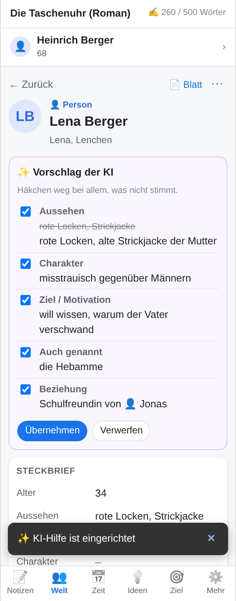

# 📖 Buchwerkstatt

*🇬🇧 English summary [below](#english).*

**Für alle, die einen Roman schreiben.** Eine Erweiterung für **Google Docs**, die beim Romanschreiben den Überblick behält: Figuren mit ausführlichem Steckbrief, Orte, Gegenstände, Zeitstrahl, Ideen-Pinnwand, Notizen und Schreibziel stehen direkt neben dem Manuskript.

Die Grundidee: **Es gibt nur einen Notizblock.** Das erste Wort einer Notiz entscheidet, was daraus wird:

| Du tippst … | Daraus wird … |
|---|---|
| `Person Lena: 34, Hebamme, rote Locken` | neue Figur **Lena** |
| `Ort Hafen: riecht nach Diesel` | neuer Ort |
| `Ding Taschenuhr: gehörte dem Vater` | neuer Gegenstand |
| `Zeit 12. März: Lena trifft Jonas` | Ereignis im Zeitstrahl |
| `Idee: Was, wenn Jonas der Bruder ist?` | Karte auf der Pinnwand |
| `@Lena hat eine Narbe an der Hand` | Notiz zu Lena |
| einfach Text | normale Notiz an dieser Stelle im Text |

**Bekannte Namen werden automatisch verlinkt.** Das gilt auch für Spitznamen und Rollen wie „der Vater“, wenn sie bei der Karte unter „Auch genannt“ stehen. Ein Klick auf einen Namen öffnet die Karte. Dort steht automatisch, womit die Karte verbunden ist, welche Notizen sie erwähnen und in welchen Kapiteln sie vorkommt.

<p>




</p>

## Was sie kann

- **📌 Notizen an Absatz oder Wort heften:** Jede Notiz hat oben rechts einen Pin.
  - Ein Klick heftet sie an den **Absatz**, in dem der Cursor steht.
  - Ist im Text ein **Wort oder Satzteil markiert**, hängt sie **genau daran**; auf der Notiz steht dann z. B. 📌 „Taschenuhr“.
  - Ein Klick auf eine angeheftete Notiz springt zur Stelle; ein angeheftetes Wort wird dabei markiert.
  - Über ⋯ lässt sich eine Notiz neu anheften oder vom Text lösen.
  - Neue Notizen werden auf Wunsch automatisch angeheftet. „📍 Hier“ zeigt die Notizen zum aktuellen Kapitel in der Reihenfolge des Textes.
- **👤 Karte unter dem Cursor:** Steht der Cursor auf einem Namen, erscheint oben die Kurzinfo zur Figur. Sonst zeigt die Leiste, wer im aktuellen Absatz vorkommt.
- **👥 Welt:** Alle Figuren, Orte und Gegenstände mit Steckbrief, Beschreibung, Beziehungen („Tochter von“) und automatischen Verbindungen. Eigene Arten (z. B. „Organisation“) lassen sich mit eigenen Feldern anlegen.
- **🗂️ Ausführlicher Steckbrief:** Personen haben einen Fragebogen mit acht Bereichen (Grunddaten, Aussehen, Familie, Beziehungen, Arbeit & Alltag, Innenleben, Auftreten, In der Geschichte). Jedes Feld hat eine Leitfrage, damit man jeden Bereich wirklich durchdenkt. Orte und Gegenstände haben kleinere Fragebögen.
  - In der Seitenleiste lassen sich die Bereiche aufklappen; daneben steht, wie viel schon ausgefüllt ist.
  - **★ Stern:** Felder mit Stern stehen auf der Karte ganz oben, ohne Aufklappen. Mit ☆ neben einem Feld kommt es dazu, mit ★ wieder weg – das gilt für alle Karten derselben Art. Voreingestellt sind die wichtigsten Felder (Alter, Aussehen, Beruf …).
  - **🖼️ Bild:** Ein Klick auf den runden Avatar einer Karte lädt ein Bild hoch oder lässt Gemini eines malen (gemalt, Foto oder Skizze, nach Steckbrief und Beschreibung, mit optionalem Wunsch wie „mit Hut“). Das Original liegt als JPEG im Welt-Ordner, die Vorschau im Blatt „Bilder“ der Tabelle; das Bild erscheint auch im Personenblatt.
  - **⤢ Im großen Fenster öffnen** öffnet ein großes Fenster: links die Bereiche mit Fortschritt, rechts die Fragen mit viel Platz. Das Manuskript bleibt dabei bedienbar.
  - Mit KI schlägt **✨ Aus den Notizen vorschlagen** Antworten für den gerade offenen Bereich vor.
  - Unter **⚙️ Mehr → Schlüsselwörter & Felder** lässt sich zwischen ausführlichem Fragebogen und kurzer Liste wechseln oder alles selbst schreiben: `# Familie` beginnt einen Bereich, `Eltern | Wer sind die Eltern?` gibt dem Feld eine Leitfrage.
- **📅 Zeitstrahl:** Ereignisse nach Datum im Buch sortiert, filterbar nach Figur. Erkannt werden z. B. „12. März“, „3.4.1987“ und „Tag 5“.
- **💡 Pinnwand:** Ideen nach offen, verwendet und verworfen sortiert.
- **🗺️ Landkarte:** Eine eigene Karte (Zeichnung, Scan, Foto) hochladen und die Orte als Fähnchen darauf verteilen – aus der Liste ziehen oder per Doppelklick neu anlegen. Ein Klick aufs Fähnchen zeigt Steckbrief-Felder, Beschreibung und Verbindungen. Mehrere Karten pro Buch (Welt, Stadt …); das Bild liegt in der Tabelle, damit alle Mitschreibenden es sehen. Zu finden bei den Orten (**🗺️ Landkarte**) und im ⋯-Menü eines Ortes.
- **🎯 Ziel:** Wörter heute, Tagesziel, Verlauf der letzten 14 Tage, Serie und Fortschritt fürs ganze Buch.
- **📄 Personenblätter fürs Handy:** Zu jeder Karte entsteht automatisch ein kleines Google Doc im Ordner „*Buchtitel* – Welt“. Damit funktioniert in Google Docs **`@Lena`** als Verweis (Smart Chip), auch in der **Docs-App am iPhone**. Die Blätter sind untereinander verlinkt.
- **🖍️ Namen im Text markieren:** Färbt alle Namen im Manuskript ein. Ein Klick entfernt die Markierungen wieder.
- **🌐 Mehrsprachig:** Deutsch, Englisch, Französisch, Spanisch, Italienisch, Portugiesisch und Niederländisch. Übersetzt sind Oberfläche, Schlüsselwörter (`Personnage …`, `Personaje …`, `Quand …`), Steckbrief-Felder, Tabelle, Menü, Personenblätter und die Antworten der KI. Der Zeitstrahl versteht Datumsangaben in allen diesen Sprachen („12 de marzo de 1987“, „1er avril“, „14h30“, „March 12th“). Die Sprache wird automatisch aus dem Google-Konto übernommen oder unter **⚙️ Mehr → Sprache** gewählt.
- **✨ KI-Hilfe (rein optional, mit Gemini oder Claude):** Die Buchwerkstatt funktioniert **vollständig ohne KI**. Ohne API-Schlüssel taucht die KI nirgends auf, und mit Schlüssel lässt sie sich jederzeit wieder ausblenden.
  - *Steckbrief ausfüllen*: Die KI liest Beschreibung und alle Notizen zur Karte und schlägt Felder, weitere Namen und Beziehungen vor. Übernommen wird nur, was angehakt ist.
  - *Widersprüche prüfen*: Findet z. B. „grüne Augen“ in Kapitel 3 und „braune Augen“ in Kapitel 17.

Alle Daten liegen in einer **Google-Tabelle** in einem Ordner „*Buchtitel* – Buchwerkstatt“, nach Möglichkeit neben dem Manuskript. Die Buchwerkstatt hat nur Zugriff auf Dateien, die sie selbst angelegt hat (`drive.file`), nicht auf den Rest des Google Drive. Die Tabelle ist gut lesbar und funktioniert auch in der Google-Tabellen-App. Es gibt keinen eigenen Server, alles bleibt im eigenen Google-Konto.

## Einrichten

**Veröffentlichen im Google Workspace Marketplace:** Schritt für Schritt in [docs/VEROEFFENTLICHEN.md](docs/VEROEFFENTLICHEN.md). Startseite, Datenschutzerklärung und Store-Material liegen in [`docs/`](docs).

Für den eigenen Gebrauch reicht es, die Erweiterung als Apps-Script-Projekt an das Manuskript zu hängen. Das muss man nur einmal pro Buch machen.

### Variante A – mit `clasp` (empfohlen)

1. Manuskript in Google Docs öffnen → **Erweiterungen → Apps Script**. Es öffnet sich ein leeres Projekt. Oben links einen Namen vergeben, z. B. „Buchwerkstatt“.
2. Im Apps-Script-Editor links auf **⚙️ Projekteinstellungen** gehen und die **Skript-ID** kopieren.
3. Auf dem Computer:

   ```bash
   git clone https://github.com/Paradoxianer/buchwerkstatt.git
   ```

   ```bash
   cd buchwerkstatt && npm install
   ```

   ```bash
   npx clasp login
   ```

   ```bash
   cp .clasp.json.example .clasp.json
   ```

   In `.clasp.json` die Skript-ID eintragen. Danach:

   ```bash
   npx clasp push --force
   ```

   (Einmalig vorher unter <https://script.google.com/home/usersettings> die „Google Apps Script API“ einschalten.)
4. Das Manuskript neu laden → **Erweiterungen → Buchwerkstatt → Buchwerkstatt öffnen**.

### Variante B – ohne Werkzeuge (kopieren und einfügen)

1. Manuskript öffnen → **Erweiterungen → Apps Script**.
2. Für jede Datei aus dem Ordner [`src/`](src) im Editor über **＋ → Skript** (für `.gs`) bzw. **＋ → HTML** (für `.html`) eine Datei **mit gleichem Namen** anlegen und den Inhalt hineinkopieren:
   `Main`, `Store`, `Ablage`, `Sprachen`, `Fragebogen`, `Dokument`, `Blaetter`, `Bilder`, `Ki`, `Statistik` (Skript) sowie `Sidebar`, `Styles`, `I18n`, `I18n_fr`, `I18n_es`, `I18n_it`, `I18n_pt`, `I18n_nl`, `Core`, `App`, `Fenster`, `Fenster_Steckbrief` (HTML). Die vorhandene `Code.gs` kann gelöscht werden.
3. **⚙️ Projekteinstellungen → „Manifestdatei appsscript.json im Editor anzeigen“** aktivieren und den Inhalt von [`src/appsscript.json`](src/appsscript.json) übernehmen.
4. Speichern, das Manuskript neu laden → **Erweiterungen → Buchwerkstatt → Buchwerkstatt öffnen**.

### Beim ersten Start

Google fragt nach Berechtigungen (Dokument, Tabellen, Drive und Internetzugriff, Letzteres nur für die optionale KI). Da die Erweiterung nicht im Marketplace veröffentlicht ist, erscheint „Google hat diese App nicht überprüft“. Dann auf **Erweitert → Zu Buchwerkstatt wechseln** klicken. Das ist bei eigenen Skripten normal.

Wer die Seitenleiste benutzt, muss die Berechtigungen **selbst** bestätigen. Also beim ersten Mal am besten mit dem Konto öffnen, mit dem auch geschrieben wird.

### KI-Hilfe einschalten (optional)

1. Einen API-Schlüssel erstellen – eine von beiden KIs genügt:
   - **Gemini (Google):** <https://aistudio.google.com/apikey>. Es gibt ein kostenloses Kontingent; dort darf Google die gesendeten Texte allerdings zur Verbesserung seiner Dienste verwenden. Für ein unveröffentlichtes Manuskript besser die Abrechnung aktivieren.
   - **Claude (Anthropic):** <https://console.anthropic.com/settings/keys>, etwas Guthaben aufladen.
2. In der Seitenleiste unter **⚙️ Mehr → KI-Hilfe** den Schlüssel einfügen. Welche KI gemeint ist, erkennt die Buchwerkstatt am Schlüssel (`AIza…` = Gemini, `sk-ant-…` = Claude).

Der Schlüssel wird nur in den Benutzereinstellungen des eigenen Google-Kontos gespeichert, nicht im Dokument. Bei Claude kostet eine Anfrage je nach Menge der Notizen meist weniger als einen Cent; das Modell lässt sich in den Einstellungen wählen (voreingestellt: Claude Opus 5.5). Bei Gemini wird immer das aktuelle Gemini Flash verwendet (`gemini-flash-latest`).

## Tipps

- **Kapitel** werden an Überschriften erkannt (Titel, Überschrift 1–3). Wer Kapitel als Überschrift formatiert, bekommt „📍 Hier“ und „Wo kommt Lena vor?“ geschenkt.
- **Umbenennen** ist sicher: Der alte Name wandert automatisch zu „Auch genannt“, bestehende Notizen bleiben verlinkt.
- Bei **„Heinrich Berger“** werden auch „Heinrich“ und „Berger“ allein erkannt, solange es eindeutig ist. Auch der Genitiv wird erkannt („Lenas“).
- `@Name`, den es noch nicht gibt, erscheint gestrichelt. Ein Klick darauf legt ihn als Person, Ort oder Gegenstand an.
- Die Schlüsselwörter („Person“, „Figur“ …) und die Felder im Steckbrief sind unter **⚙️ Mehr** frei änderbar.
- **⏎** speichert, **⇧⏎** macht eine neue Zeile. Bei Vorschlägen wählt **↑↓** aus und **⏎/Tab** übernimmt.
- Die Personenblätter werden überschrieben. Änderungen also immer in der Seitenleiste machen.

## Entwicklung

```
src/            Apps-Script-Projekt (wird mit clasp hochgeladen)
  Main.gs         Menü, Seitenleiste
  Store.gs        Tabelle als Datenablage, Einstellungen
  Ablage.gs       Drive-Zugriff (nur eigene Dateien, drive.file) über die Drive-API
  Sprachen.gs     Server-Texte und Standard-Schlüsselwörter/Felder je Sprache
  Fragebogen.gs   Ausführliche Steckbriefe (Bereiche mit Leitfragen) je Sprache
  Dokument.gs     Cursor, Textstellen (Named Ranges), Kapitel, Markieren, Vorkommen
  Blaetter.gs     Personenblätter als Google Docs
  Bilder.gs       Bilder zu Karten (Original in Drive, Vorschau im Blatt „Bilder“)
  Ki.gs           Claude- und Gemini-API (Felder füllen, Widersprüche prüfen, Bilder malen)
  Statistik.gs    Wortzahl & Tagesverlauf
  Version.gs      Versionsstempel – entsteht beim Hochladen (npm run push), nicht im Repo
  Sidebar.html    Gerüst der Seitenleiste
  Styles.html     Aussehen
  I18n.html       Übersetzungen der Oberfläche (Deutsch, Englisch) und Sprachwahl
  I18n_xx.html    weitere Sprachen (fr, es, it, pt, nl) – je ein Wörterbuch
  Core.html       Logik ohne Oberfläche: Notiz zerlegen, Namen finden, Datum sortieren
  App.html        Oberfläche
  Fenster.html    Großes Fenster: Rahmen (Laden, Sprache, Speichern) für austauschbare Ansichten
  Fenster_Steckbrief.html  Ansicht „Steckbrief“ im großen Fenster
dev/            Vorschau ohne Google (mock.js ersetzt google.script.run)
tests/          Tests (Kernlogik, Vollständigkeit der Sprachen, Marketplace-Voraussetzungen)
docs/           Startseite, Datenschutz, Nutzungsbedingungen (GitHub Pages), Store-Material, Veröffentlichungsanleitung
```

```bash
npm test
```

```bash
npm run vorschau
```

`npm run vorschau` baut `dist/vorschau.html` mit Beispieldaten. Die Datei lässt sich einfach im Browser öffnen. Am Ende der Adresse startet `#leer` mit einem leeren Buch, `#ki` mit eingerichteter KI, und ein Sprachkürzel (`#en`, `#fr`, `#es`, `#it`, `#pt`, `#nl`) wählt die Sprache. Die Zusätze lassen sich kombinieren, z. B. `#leer-fr-ki`. Daneben entsteht `dist/fenster.html` mit dem großen Steckbrief-Fenster (`#id=p1` wählt die Karte).

`npm test` prüft auch, dass jede Sprache alle Texte mit denselben Platzhaltern hat.

### Neue Sprache hinzufügen

1. `src/I18n_xx.html` nach dem Muster von `I18n_fr.html` anlegen (gleiche Schlüssel wie `de` in `I18n.html`) und in `Sidebar.html` einbinden.
2. `src/Sprachen.gs`: in `BW_TEXTE` und `BW_STANDARD_ARTEN` ergänzen und in `BW_SPRACHEN` aufnehmen. Für die KI zusätzlich den Sprachnamen in `BW_KI_SPRACHEN` (`Ki.gs`) eintragen.
3. `src/Core.html`: Monatsnamen in `MONATE` und das Wort für „Tag“ in `TAG_WOERTER` ergänzen, damit der Zeitstrahl Datumsangaben erkennt.

---

## English

**For everyone writing a novel.** **Buchwerkstatt** (“book workshop”) is a Google Docs add-on for novelists: characters with in-depth profiles, places, objects, a timeline, an idea board, notes and a writing goal, right next to your manuscript. It works **entirely without AI**. Gemini or Claude can optionally fill in character profiles, look for contradictions, and (Gemini) paint character pictures.

There is just one note field, and the first word decides what a note becomes:

| You type … | You get … |
|---|---|
| `Character Lena: 34, midwife, red curls` | a new character card |
| `Place Harbour: smells of diesel` | a new place |
| `Object Pocket watch: belonged to her father` | a new object |
| `When March 12: Lena meets Jonas` | a timeline event |
| `Idea: What if Jonas is her brother?` | an idea-board card |
| `@Lena has a scar on her hand` | a note about Lena |

Known names (and nicknames listed under “Also called”) are linked automatically. Notes are pinned invisibly to the paragraph where your cursor is. For each card a small Google Doc is created, so `@Lena` works as a smart chip in Google Docs, even on a phone.

Every note has a 📌 pin: one click pins it to the paragraph your cursor is in – or exactly to a word you have selected.

Available in German, English, French, Spanish, Italian, Portuguese and Dutch. The language follows your Google account or can be chosen under **⚙️ More → Language**. Setup works as described above: attach the `src/` files to your manuscript via **Extensions → Apps Script**, either with `clasp` or by copy and paste.
